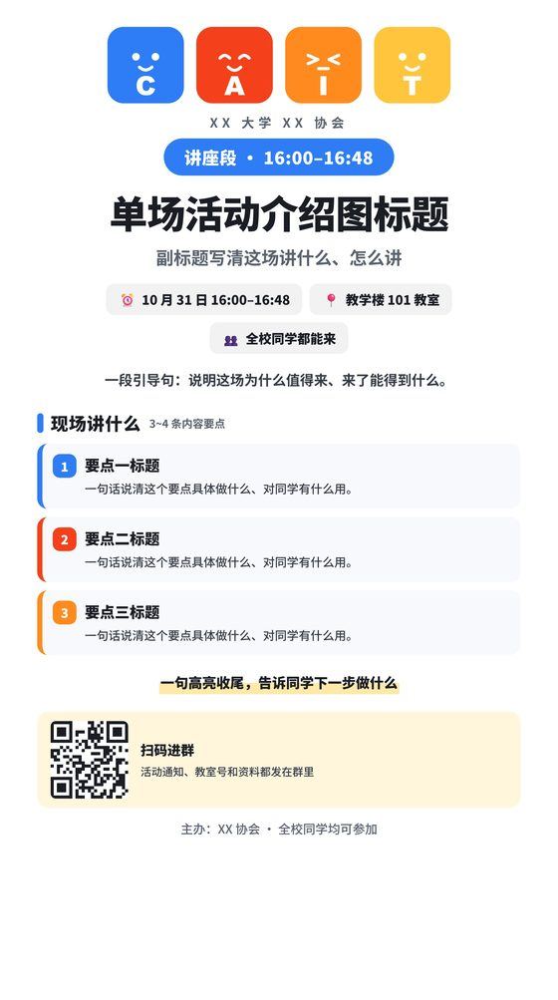
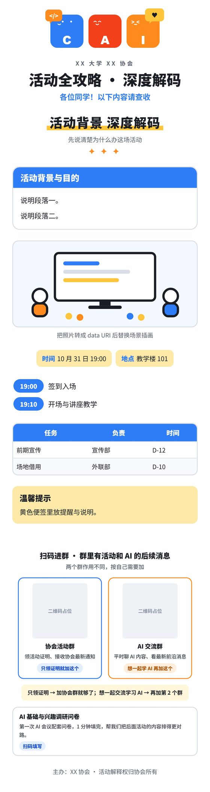

# poster-studio

> 一键生成"活泼扁平卡通风"活动海报 / 宣传图 / 卖点图 / 干货长图 / 议程长图 / 单场介绍图的 Agent Skill。
> 改一份 JSON 配置，得到一个**单文件 HTML**（双击就能改、能再导出），以及一张**JPG 成品图**。
> 零构建工具、零网络依赖、零 npm 包。


## 这是什么

一套可以直接放进 AI Agent（DeepSeek Harness / Claude Code 等）的 **skill**：把"照着好看的参考图做一张海报"变成"改一份 JSON 配置"。

设计语言提炼自一组扁平卡通风的科技活动海报：白底 + 四色平涂、全圆角无投影、特粗黑体短句、卡通吉祥物 + 涂鸦装饰、黄底贴纸 + 二维码 CTA。三份文档把这套语言写成了可复用参数：

| 文件 | 作用 |
| --- | --- |
| `SKILL.md` | 工作流主文档：选模板 → 改配置 → 预览 → 导出 → 质检 |
| `DESIGN-LANGUAGE.md` | 设计语言拆解与设计 token（配色 / 字号 / 圆角 / 装饰件 / 5 种构图配方） |
| `COPYWRITING.md` | 中文文案规则：标题公式、正文行规则、CTA 动词库、AI 味禁用词表 |

## 五个模板

每个模板都是**自包含单文件 HTML**：内联 CSS + 内联 JS + 内联导出模块，不请求任何外部资源。

| 模板 | 尺寸 | 适合做什么 |
| --- | --- | --- |
| `assets/template-promo.html` | 1080×1920 | 活动主宣传 / 招新 / 比赛预告（大标题 + 花括号正文 + 吉祥物 + 日期贴纸 + 二维码） |
| `assets/template-spotlight.html` | 1080×1496 | 卖点图 / 朋友圈传播图（巨大描边对话气泡 + 三行大字：痛点 → 主张 → 收益） |
| `assets/template-long.html` | 750×自动高 | 干货 / 流程 / 任务分工长图（品牌头 + 手写分节标题 + 同构卡片 ×N） |
| `assets/template-agenda.html` | 930×自动高 | 论坛 / 讲座 / 会议议程长图（书签标签 + 白卡 + 时间轴 + 嘉宾卡 + 证明规则） |
| `assets/template-talk.html` | 1080×自动高 | 单场讲座 / 单场会议介绍图（场次徽章 + 要点卡 / 讲者卡 + 二维码横条） |

| 主视觉 | 卖点图 | 单场介绍图 |
| --- | --- | --- |
|  |  |  |

| 干货长图 | 议程长图 |
| --- | --- |
|  |  |

## 快速开始

```bash
git clone https://github.com/MakeBlackSheepGreat/poster-studio.git
```

**方式一：直接改 HTML**

1. 复制一个模板到你的工作目录，重命名成你要的海报（例如 `海报-主视觉.html`）。
2. 用编辑器打开，只改 `<script id="config" type="application/json">` 里的 JSON —— 文字、颜色、二维码、吉祥物全在配置里，先别动 CSS。
3. 双击 HTML 在浏览器里预览，点右上角「导出 JPG」或按 `Ctrl+E`。

**方式二：命令行批量导出**

```bash
node assets/verify-export.mjs 海报-主视觉.html 海报-主视觉.jpg 2
```

输出与页面按钮**完全同一条链路**（SVG foreignObject → canvas → JPEG），并打印质检报告：

```
export ok: 海报-主视觉.jpg
  尺寸 2160×3840 · 733 KB · scale=2 quality=0.92
  posterReport: 1080×1920 · overflow=[] · shrunk=[]
```

`overflow` 是越界/被裁切的元素，`shrunk` 是被自动压缩字号的文字行，两个都该是空数组。需要本机装有 Chrome 或 Edge（可用 `CHROME_PATH` 环境变量指定路径）。

**方式三：装成 Agent Skill**

```bash
cp -r . ~/.dsh/skills/poster-studio      # DeepSeek Harness 用户级 skill 目录
```

之后在会话里说「做一张活动海报」就会命中这个 skill。

## 导出原理

页面暴露两个全局函数，`file://` 下直接可用，无外部依赖、无网络请求：

- `window.__exportJPG({ scale, quality, filename, returnDataUrl })` —— 用 SVG `foreignObject` 把海报 DOM 栅格化到 canvas，输出 JPEG。返回 `{ok, width, height, bytes}`。
- `window.__posterReport()` —— 返回 `{width, height, overflow[], shrunk[]}`，给自动化质检用。

为了保证导出稳定，模板遵守几条约束：图片必须 data URI 内联、不引网络字体（用系统字体栈）、不用 CSS filter / mix-blend-mode / backdrop-filter、不放视频和 iframe。

## 辅助脚本

| 脚本 | 依赖 | 用途 |
| --- | --- | --- |
| `assets/verify-export.mjs` | Node 18+、本机 Chrome/Edge | 无头浏览器导出 JPG + 溢出/压缩双告警 |
| `assets/make-qr.py` | `pip install segno Pillow` | 生成真实二维码 PNG 和可直接粘进 config 的 data URI |
| `assets/verify-qr.py` | `pip install zxing-cpp Pillow` | 解码导出图里的二维码，可断言期望 URL（抓残留的示例码） |
| `assets/qc-split.py` | `pip install Pillow` | 长图切片降采样，方便逐段目检 |

## 质检清单（每次出图必做）

1. **看导出的 JPG，不是看 HTML**：标题无截断、无压字，四边留白 ≥ 60px，颜色只出现在色块与关键词上。
2. **跑导出报告**：`overflow=[]` 且 `shrunk=[]`。`shrunk` 非空说明某行文案太长被压了字号，改短文案或调大该槽位字号。
3. **解码二维码**：`python assets/verify-qr.py 海报.jpg --expect <真实URL>`。光看图上有没有黑白方块没用 —— 占位码和残留的旧码也是黑白方块，只有解出 URL 才算通过。
4. **长图先切片**：单边超过 8192px 的 JPG 很多看图工具打不开，用 `python assets/qc-split.py 海报.jpg 3` 切段再看。

## 几个踩过的坑（已修在模板里）

- **品牌色块压住机构名/标题**：色块容器尺寸和 SVG 自带 `width` 不一致时，SVG 会按原始尺寸溢出容器。每个模板的 `.brand-block` 后面必须有 `.brand-block svg{width:100%;height:100%;display:block}`。
- **配了多群二维码尾块还渲染单码**：同一张图上会出现两次同一个群码。模板已内置互斥判断（检测到 `qrGroups` 就跳过单码块），改模板时别拆掉。
- **落款消失**：落款渲染如果只写在会被跳过的分支里（比如 `if(!qrGroups)` 内部），配了多群尾块后整段落款就没了。模板做了 `cfg.cta.footer || cfg.footer` 兜底，并把落款放在尾块之后。
- **日期写两个备选**：海报是给一群人看的，摆两个日期会让报名的人不知道该按哪天准备。只写一个确定日期，要改期走群通知。

## 目录结构

```
poster-studio/
├── SKILL.md                  ← 工作流主文档
├── DESIGN-LANGUAGE.md        ← 设计语言拆解与 token
├── COPYWRITING.md            ← 中文文案规则
├── docs/                     ← README 预览图
└── assets/
    ├── template-promo.html       ← 1080×1920 主视觉
    ├── template-spotlight.html   ← 1080×1496 卖点对话框
    ├── template-long.html        ← 750 宽长图
    ├── template-agenda.html      ← 930 宽议程长图
    ├── template-talk.html        ← 1080 宽单场介绍图
    ├── verify-export.mjs         ← 无头导出 + 双告警
    ├── make-qr.py                ← 真实二维码生成
    ├── verify-qr.py              ← 二维码解码核对
    └── qc-split.py               ← 长图质检切片
```

## 说明

- 模板里的示例文案、机构名、二维码都是**占位内容**（`XX 大学 XX 协会`、`教学楼 101`、`data:image/png;base64,...`），发布前替换成自己的。
- 二维码默认渲染占位图形；把真实二维码转成 data URI 填进 `qr.image`（或用 `qrGroups` 放多个群）才会出真码。
- 模板里的中文字体栈是 `"PingFang SC","Microsoft YaHei","Noto Sans SC","Source Han Sans SC",sans-serif`，不引网络字体，导出才不会掉字体。

## License

MIT
