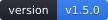
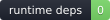
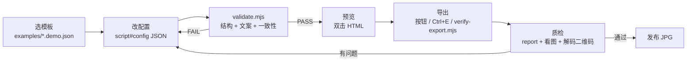
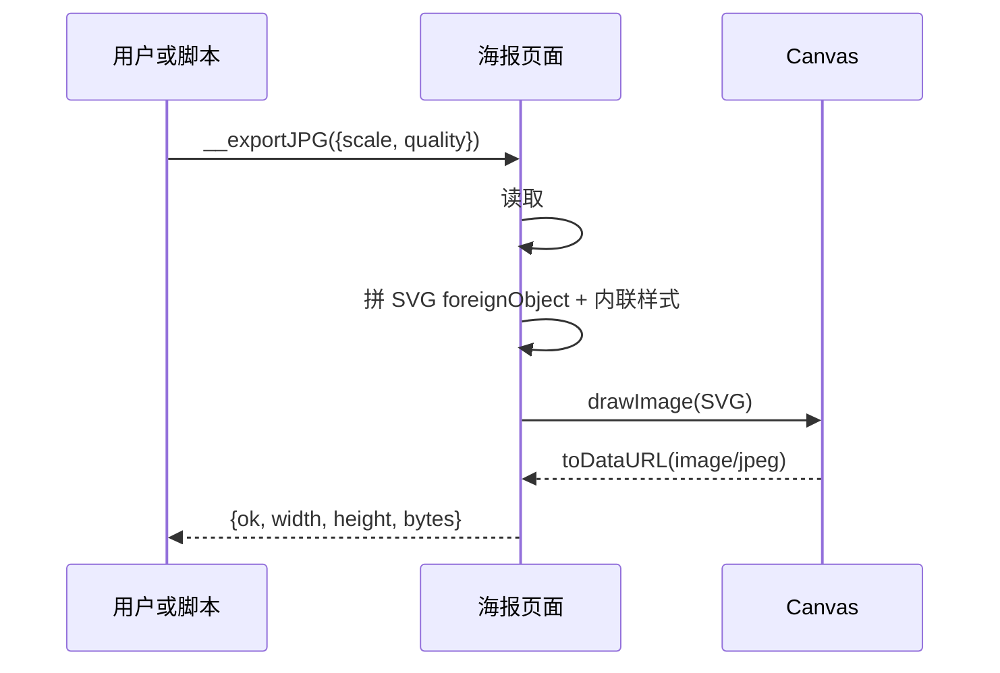

<div align="center">

   

# poster-studio

**把「照着参考图做一张海报」变成「改一份 JSON」。**

改配置 → 得到自包含的单文件 HTML → 一键导出 2 倍分辨率 JPG。
零构建工具、零网络请求、零运行时依赖。

</div>

## 效果

<table>
<tr>
<td align="center"><br><sub><b>主视觉</b> 1080 × 1920</sub></td>
<td align="center"><br><sub><b>卖点对话框</b> 1080 × 1496</sub></td>
<td align="center"><br><sub><b>单场介绍图</b> 1080 × ≥1920</sub></td>
</tr>
<tr>
<td align="center"><br><sub><b>干货长图</b> 750 × 自动高</sub></td>
<td align="center"><br><sub><b>议程长图</b> 930 × 自动高</sub></td>
<td align="center"><sub>以上截图由 <code>tools/build-previews.mjs</code><br>用仓库内的示例配置导出，<br>不含任何真实机构、人名与群二维码。</sub></td>
</tr>
</table>

## 它解决什么

活动海报每次都要重画：字号、圆角、间距、二维码位置全靠手感，换个人做就走形。poster-studio 把这套视觉固化成五个模板，版式写在 CSS 里，内容只写进一份 JSON：

- **五个模板**覆盖活动主宣传、卖点图、干货长图、议程长图、单场介绍图。
- **五个导出链路一致**：页面按钮、快捷键、命令行都走同一个 `__exportJPG()`。
- **约束写进代码**：结构由 JSON Schema 校验，文案字数与禁用词由规则文件执行，模板不许引外链。
- **导出可核对**：`__posterReport()` 报出越界元素与被压缩字号的文字行，二维码用 zxing 解码断言。

## 30 秒上手

```bash
git clone https://github.com/MakeBlackSheepGreat/poster-studio.git
cd poster-studio
cp assets/template-promo.html 海报.html   # 换个名字
node assets/verify-export.mjs 海报.html 海报.jpg 2
```

用编辑器打开 `海报.html`，只改 `<script id="config" type="application/json">` 里的 JSON，双击预览，点「导出 JPG」或按 `Ctrl+E`。

命令行导出会打印一份报告：

```text
export ok: 海报.jpg
  尺寸 2160×3840 · 733 KB · scale=2 quality=0.92
  posterReport: 1080×1920 · overflow=[] · shrunk=[]
```

`overflow` 是越界或被裁切的元素，`shrunk` 是被自动压缩字号的文字行。两个都是空数组才算过。

需要 Node 22+ 和本机 Chrome 或 Edge；浏览器路径可以用 `CHROME_PATH` 指定。

## 模板

<!-- gen:templates-readme:start -->
| 模板 | 文件 | 画布 | 用途 |
| --- | --- | --- | --- |
| 主视觉 | `assets/template-promo.html` | 1080 × 1920 | 活动主宣传、招新、比赛预告 |
| 卖点对话框 | `assets/template-spotlight.html` | 1080 × 1496 | 卖点图、朋友圈传播图 |
| 干货长图 | `assets/template-long.html` | 750 × 自动高 | 干货、流程、任务分工长图 |
| 议程长图 | `assets/template-agenda.html` | 930 × 自动高 | 论坛、讲座、会议议程长图 |
| 单场介绍图 | `assets/template-talk.html` | 1080 × ≥1920 | 单场讲座、单场会议介绍图 |
<!-- gen:templates-readme:end -->

每个模板都是自包含单文件：内联 CSS、内联渲染脚本、内联导出模块，不请求外部资源。

## 工作流



## 导出链路



页面按钮、`Ctrl+E`、`verify-export.mjs` 调用的是同一个函数，所以三种导出结果一致。

## 配置与约束

配置结构定义在 `assets/schema/poster-config.schema.json`，每个模板对应一个 `$defs/<id>`。文案上限、禁用词、CTA 动词库、日期格式在 `assets/rules/copy-rules.json`。

```bash
npm install          # 只装校验用的 ajv
node assets/validate.mjs
```

校验会做这些事：

| 检查 | 依据 |
| --- | --- |
| 模板内联配置与 `examples/<id>.demo.json` 完全一致 | 两份内容做规范化比较 |
| 配置结构、颜色枚举、图片格式 | JSON Schema（ajv） |
| 标题、正文、卡片标题的字数上限 | `copy-rules.json` 的 `limits` |
| 禁用词与禁用句式 | `copy-rules.json` 的 `bannedWords`、`bannedPatterns` |
| 日期是否写成「X 月 X 日」且月份日期合法 | 正则加范围判断 |
| 配了 `qrGroups` 还留单码图片 | 二维码互斥规则 |
| 模板是否引了外链、iframe，导出接口是否齐全 | 正则扫描模板 HTML |
| `VERSION`、`SKILL.md`、README 表格是否同步 | 生成区块比对，`--write` 可重写 |

任何一项不过就退出码 1，CI 直接拦下。

## 脚本

<!-- gen:scripts:start -->
| 文件 | 作用 |
| --- | --- |
| `assets/validate.mjs` | 校验配置结构、文案规则、模板自包含与文档一致性 |
| `assets/verify-export.mjs` | 无头浏览器导出 JPG（Node 22+ 与本机 Chrome/Edge），返回溢出与文字压缩报告 |
| `assets/make-qr.py` | 生成真实二维码 PNG 与 data URI |
| `assets/verify-qr.py` | 解码导出图里的二维码，可断言期望地址 |
| `assets/qc-split.py` | 长图切片降采样，便于逐段目检 |
| `tools/build-previews.mjs` | 重新导出 docs 预览图 |
<!-- gen:scripts:end -->

二维码相关脚本需要 Python 依赖：

```bash
pip install segno Pillow zxing-cpp
```

## 质检

```bash
node assets/verify-export.mjs 海报.html 海报.jpg 2          # 导出并检查溢出/压缩
python assets/verify-qr.py 海报.jpg --expect https://example.com/join
python assets/qc-split.py 海报.jpg 3                       # 长图切片
```

- `overflow` 非空：有元素超出画布或被裁切。
- `shrunk` 非空：某行文字被自动缩了字号，改短文案或调整槽位字号。
- 二维码必须解码出预期地址。占位图形和残留的旧码也是黑白方块，只有解出 URL 才算过。

## 隐私

模板里的机构名、地点、人物、二维码全部是占位内容：`示例大学 · 开源协会`、`实训楼 302`、空字符串图片字段。仓库内的截图由示例配置导出，不含真实群码与人名。

发布前替换成自己的内容；二维码用 `make-qr.py` 生成 data URI 再填进配置。

## 目录

| 路径 | 内容 |
| --- | --- |
| `SKILL.md` | Agent 使用说明：工作流、配置约定、导出接口、质检 |
| `DESIGN-LANGUAGE.md` | 设计语言拆解与 token：配色、字号、圆角、装饰件、五种构图 |
| `COPYWRITING.md` | 中文文案规则：标题公式、正文槽位、CTA 动词库、改写示例 |
| `assets/` | 五个模板、校验与导出脚本、Schema 与规则 |
| `examples/` | 五个模板的可运行示例配置 |
| `docs/` | README 截图与徽章 |
| `tools/` | 预览图与徽章生成脚本 |

## 作为 Agent Skill 安装

```bash
cp -r . ~/.dsh/skills/poster-studio
```

之后在会话里说「做一张活动海报」就会命中这个 skill。

## License

MIT
